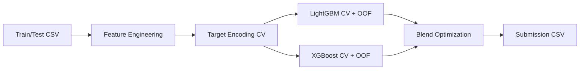

# Traffic Demand Prediction - ML Pipeline

LightGBM + XGBoost ensemble with feature engineering, leak-free target encoding, and Optuna tuning. Built for high-performance tabular regression on time- and location-driven traffic data.

## Requirements


## Architecture at a Glance



## Model Architecture

### Why LightGBM + XGBoost?

Both are gradient-boosted tree models but learn different boundaries. Blending their OOF predictions reduces variance without raising bias, typically improving $R^2$ by 1 to 3 points.

| Model | Why it works here |
| --- | --- |
| LightGBM | Fast, handles mixed types, strong on tabular data with time-based features. GPU-accelerated on A100. |
| XGBoost | Different bias from LightGBM; blending improves $R^2$ by 1 to 3 points. |
| Optuna HPO | 50-trial Bayesian search to optimize `num_leaves`, learning rate, and regularization. |

### Ensemble Strategy

- Train LightGBM with 5-fold CV, store OOF predictions.
- Train XGBoost with the same folds, store OOF predictions.
- Use `scipy.optimize.minimize_scalar` to find best blend coefficient $\alpha$.
- Final prediction: $\alpha \cdot \hat{y}_{lgb} + (1 - \alpha) \cdot \hat{y}_{xgb}$.

## Feature Engineering

The pipeline converts raw timestamp, geohash, and categorical fields into a high-signal feature set.

### Feature Groups

| Feature Group | Generated Columns | Purpose |
| --- | --- | --- |
| Timestamp Parsing | `hour`, `minute`, `time_of_day` | Fractional time captures continuous demand patterns. |
| Cyclical Encoding | `hour_sin`, `hour_cos`, `day_sin`, `day_cos` | Preserves periodicity and avoids boundary discontinuities. |
| Rush Hour Flags | `is_morning_rush`, `is_evening_rush`, `is_night`, `is_midday` | Binary indicators for predictable spikes. |
| Geohash Decode | `lat`, `lon` | Approximate coordinates from geohash strings. |
| Geohash Prefixes | `geo_prefix3`, `geo_prefix4`, `geo_len` | Coarser spatial buckets for smooth target encoding. |
| Target Encoding (CV) | `geohash_te`, `geo_prefix3_te`, `geo_prefix4_te`, `RoadType_te`, `Weather_te` | Leak-free mean-smoothed encodings via 5-fold CV. |
| Interaction Features | `lanes_x_roadtype`, `rush_x_lanes`, `temp_x_weather`, `geo_x_hour`, `weekend_x_rush`, `landmark_x_rush` | Captures cross-feature effects. |
| Day Encoding | `day_num`, `is_weekend` | Distinguishes weekday/weekend demand. |

### Cyclical Time Encoding

```python
hour_sin = np.sin(2 * np.pi * hour / 24)
hour_cos = np.cos(2 * np.pi * hour / 24)
day_sin = np.sin(2 * np.pi * day_num / 7)
day_cos = np.cos(2 * np.pi * day_num / 7)
```

## Pipeline Steps

| Step | What happens | Output |
| --- | --- | --- |
| Load | Read train/test CSV | `train_df`, `test_df` |
| Features | Time, geohash, categoricals, interactions | Enriched tables |
| Target Encoding | CV-encoded geohash + categories | Leak-free encodings |
| LightGBM CV | 5-fold training + OOF | `oof_preds`, `test_preds` |
| XGBoost CV | 5-fold training + OOF | `xgb_oof`, `xgb_test` |
| Blend | Optimize $\alpha$ | `final_test` |
| Save | Create submission | `submission.csv` |

## Environment

```
Environment : NVIDIA A100 PCIe 80GB (GA100) | Ubuntu 22.04 LTS
CUDA        : 12.2  |  Driver: 535.104.05
Python      : 3.10.12
```

## Usage

1. Update dataset paths in the script:

```python
DATA_DIR   = '/home/ubuntu/traffic_demand/data'
OUTPUT_DIR = '/home/ubuntu/traffic_demand/outputs'
```

2. Run the pipeline script to generate a submission CSV.

## Results

- OOF $R^2$ is printed after CV training.
- XGBoost OOF $R^2$ is printed after XGBoost training.
- Blended $R^2$ and competition score are printed after the ensemble step.
- Final submission is saved to `OUTPUT_DIR/submission.csv`.

## Reproducibility Notes

- Fixed random seeds (`random_state=42`).
- Target encoding uses 5-fold CV to prevent leakage.
- GPU settings enabled for both LightGBM and XGBoost.

## Team

Nikhil Verma, Garima Varma, Mohit Srivastava, Shreyash Raj

